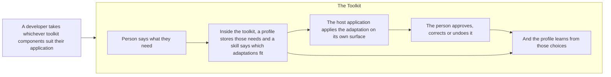

# AI for Accessibility Toolkit

**An open toolkit for building apps that adapt to each person's accessibility needs.**

[](LICENSE)

---

## What It Is

The toolkit is a set of parts a developer can use to make an app adapt to a person. It can:

- Learn what a person needs, e.g., larger text or fewer animations
- Keep those needs in a profile on the person's device
- Turn the profile into skills — sets of adaptations that fit
- And turn those skills into adaptations that change the app for that person

You choose which parts to use and how your app uses them.

---

## How It Fits



---

## What It Isn't

- **Not an auditor.** An auditor scans a site and gives the developer a report. This toolkit changes the app for the person using it, based on their profile.
- **Not an overlay.** An overlay is added by a site owner, often to tick a compliance box, and gives everyone the same widget. With this toolkit, each person's own profile decides which adaptations fit, and site owners don't install anything.
- **Not assistive technology.** It doesn't replace a screen reader, a magnifier or anything else a person relies on. It's built to work alongside them.
- **Not an app or a browser project.** The core has no user interface. We started with the browser because it was the easiest way to get feedback from people, but web, mobile, XR, desktop and server apps are all supported.

---

## Key Terms

These four words are used throughout the docs. The code uses its own names for them, listed in the last column. See [GLOSSARY.md](docs/GLOSSARY.md) for every term and [docs/architecture.md](docs/architecture.md) for how the parts fit together.

| Word | Meaning | In the Code |
|------|---------|-------------|
| **Need** | What a person says they need, in their own words | free text, `supportAreas[]`, `onboardingSteps[]` |
| **Profile** | What the toolkit knows about a person's needs, shared with other apps only with the person's permission | the **AbilityModel** (the profile in a form every renderer can read) and the **Librarian** (the agent that keeps the profile, learns from setting changes, and controls what other apps can read) |
| **Skill** | Which adaptations to apply, and with what settings, for a need | a **SKILL.recipe** — validators, authors, validators, presets, ports, the registry in `toolkit/registry/` |
| **Adaptation** | A change an app makes for the person | adapter modules in `tools/adapters/`; auditors in `tools/auditors/`; the ports in `toolkit/platforms/` |

---

## Try It

No install, API key or browser needed. From a clone of the repository:

```bash
node toolkit/hosts/xr-demo/demo.js        # A profile made on the web is shared with an XR app
node toolkit/hosts/skill-demo/demo.js     # Finds, builds, checks and saves a skill
node examples/cross-surface.mjs           # One profile turned into web and XR settings
```

[docs/QUICKSTART.md](docs/QUICKSTART.md) walks through the code, and [toolkit/API.md](toolkit/API.md) lists every method.

---

## Building On It

There are four ways to use the toolkit:

1. **Use the core directly** in any JavaScript runtime. `createToolkit({ ports })` returns `{ datastore, librarian }`. Implement the ports for your platform, starting from the Node version in [toolkit/platforms/node/](toolkit/platforms/node/). There's also a Chrome version in [toolkit/platforms/chrome/](toolkit/platforms/chrome/).
2. **Call the hosted service** from any language. Run [server/](server/) locally or on Cloud Run, and call the same Library methods over HTTP with a bearer token (see [server/README.md](server/README.md#running-a-workshop)).
3. **Use the catalog**. The skills, adapters, auditors and validators in [tools/](tools/) and the registry in [toolkit/registry/](toolkit/registry/) work with or without the core.
4. **Use one of the experimental parts**: a Controller that drives apps by text or voice, an example onboarding service, or a command-line tool (CLI) to try the catalog on a live page from a terminal.

[docs/COMPONENTS.md](docs/COMPONENTS.md) has more on each. [docs/ARCHITECTURE.md](docs/ARCHITECTURE.md) shows the full system.

---

## Security & Privacy

### Core Security Principles

- **Local-first by default** — Profiles live on the person's device. The toolkit doesn't phone home.
- **No PII in core** — The AbilityModel contains only accessibility preferences, no personal identifiers.
- **Consent-gated sharing** — Profiles only leave the device with explicit user consent via the Librarian's grant system.
- **No external dependencies for core** — Core runs offline; network calls only via implemented ports.
- **Supply chain** — Minimal dependencies, locked versions, `npm audit` in CI.

### Threat Model

| Threat | Mitigation |
|--------|------------|
| Profile exfiltration | Local-first storage, encrypted at rest (platform port responsibility), consent required for sharing |
| Malicious adapter | Adapter sandboxing (platform port), validator/auditor review in registry, no auto-execute |
| Supply chain attack | `package-lock.json` committed, `npm audit` in CI, minimal deps |
| Profile poisoning | User confirms each adaptation, Librarian learns from corrections, no auto-apply without consent |
| Cross-app profile leakage | Librarian enforces grants per-app, no global profile broadcast |

### Data Handling

- **Profiles** — Stored in platform KVStore (encrypted at rest on mobile, IndexedDB on web). Never sent to toolkit maintainers.
- **Adaptation logs** — Local only, for Librarian learning. User can purge.
- **Telemetry** — None by default. Opt-in only for research with explicit consent.
- **API keys** — For hosted service only. Stored in platform secure storage (Keychain/Keystore/SecureStore).

### Deployment Security

```bash
# Local development (no network exposure)
npm run dev:developer   # Starts server on localhost only

# Hosted service (Cloud Run)
# - Service account with minimal IAM
# - Cloud Armor WAF
# - Secret Manager for API keys
# - VPC-SC for network isolation
# - Binary Authorization for container images
```

### Security Checklist for Integrators

- [ ] Implement `KVStore` with encryption at rest
- [ ] Implement `Clock` and `Scheduler` ports securely
- [ ] Validate all adapter outputs before applying to UI
- [ ] Use Librarian grants for any cross-app profile sharing
- [ ] Run `npm audit` before deploy
- [ ] Review adapter/auditor code before adding to registry
- [ ] Set `Consent` port to require explicit user action

---

## Status

This is a **research prototype (pre-alpha)**, and things may break or change without notice. The adaptations in the catalog are demos and haven't been formally validated with the people they're meant for. The current research phase ends in November 2026, and plans after that aren't decided yet.

The toolkit comes from the [AI for Accessibility Collective](docs/HOW-THIS-WAS-BUILT.md). The current research phase ends in November 2026, and plans after that aren't decided yet. Open work is listed in [ROADMAP.md](ROADMAP.md).

---

## Who It's For

- People who want pages adapted to them: use the browser extensions in the [extension repository](https://github.com/AI-for-Accessibility-Collective/AI-for-Accessibility-Extension).
- Developers building an app on the web, mobile, XR, desktop or a server: use any mix of the core, the skills, the catalog and the experimental parts.
- Developers extending the toolkit: add skills, adapters, auditors, validators and presets (see [CONTRIBUTING.md](CONTRIBUTING.md)).
- Researchers working on AI agents: use the design principles and the architecture, and share benchmarks, evaluation methods and findings.

---

## Try It

No install, API key or browser needed. From a clone of the repository:

```bash
node toolkit/hosts/xr-demo/demo.js        # A profile made on the web is shared with an XR app
node toolkit/hosts/skill-demo/demo.js     # Finds, builds, checks and saves a skill
node examples/cross-surface.mjs           # One profile turned into web and XR settings
```

[docs/QUICKSTART.md](docs/QUICKSTART.md) walks through the code, and [toolkit/API.md](toolkit/API.md) lists every method.

---

## Contributing

[CONTRIBUTING.md](CONTRIBUTING.md) explains how to set up the repository and open a pull request. The main ways to contribute are:

- [Share feedback](CONTRIBUTING.md#share-feedback) on the toolkit or the extensions
- [Write a skill](CONTRIBUTING.md#write-a-skill) (no code needed)
- [Add an adapter](CONTRIBUTING.md#add-an-adapter) (no code needed)
- [Add an auditor](CONTRIBUTING.md#add-an-auditor) (no code needed)
- [Build an example app](CONTRIBUTING.md#build-an-example-app)
- [Share benchmarks, evaluation methods and findings](CONTRIBUTING.md#share-benchmarks-evaluation-methods-and-findings)

Open work is listed in [ROADMAP.md](ROADMAP.md).

---

## Repository Layout

```
toolkit/           # Platform-agnostic core: datastore, librarian, ability model, skills, registry
tools/             # Developer catalog: adapters, auditors, validators, presets
server/            # Hosted HTTP service (optional)
controller/        # Experimental text/voice controller
onboarding/        # Experimental onboarding service
examples/          # Runnable examples
docs/              # Quickstart, components, architecture, glossary, roadmap
scripts/           # Repository checks (packaged-package fix)
extension/         # Browser extensions (moved to own repo)
```

The paths that changed when the extensions moved to their own repository are listed at the top of [docs/README.md](docs/README.md).

---

## Who Built This and How

[HOW-THIS-WAS-BUILT.md](docs/HOW-THIS-WAS-BUILT.md)

---

## Partners

<div align="center">
  <p>
    <a href="https://www.stanford.edu/"></a>
    &nbsp;&nbsp;
    <a href="https://www.washington.edu/"></a>
    &nbsp;&nbsp;
    <a href="https://www.media.mit.edu/"></a>
    &nbsp;&nbsp;
    <a href="https://www.globaldisabilityinnovationhub.com/"></a>
    &nbsp;&nbsp;
    <a href="https://www.google.org/"></a>
  </p>
</div>

---

## License

Licensed under Apache 2.0 ([LICENSE](LICENSE)).